<div align="center">

  

  <br/>

  <a href="https://github.com/NemikaA">
    
  </a>

  <br/>
  <code>📍 Sri Lanka &nbsp;•&nbsp; ♥ Aspiring AI / ML Engineer & Data Scientist</code>

</div>

<br/>

```
  ♥   * Nemika appeared.
      * They are armed with Python and an obsession with machine learning.
      * Their DETERMINATION cannot be measured.
```

<br/>

---

<div align="center">

  

  <br/><br/>

  

  <br/><br/>

  

  <br/>

  <code>
    <a href="https://github.com/NemikaA/sinhala-akuru-ai">[sinhala-akuru-ai]</a> &nbsp;
    <a href="https://github.com/NemikaA/BotWars2026">[BotWars2026]</a> &nbsp;
    <a href="https://github.com/NemikaA/MTUK-TUK">[MTUK-TUK]</a>
  </code>

</div>

<br/>

---

<div align="center">

```
  ♥   * [NEMIKA] used  DETERMINATION.
      * It's super effective.
```

  

</div>
