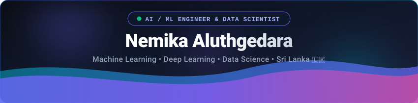

<div align="center">

  <!-- Undertale Battle Screen Header -->
  

  <br/>

  <!-- Animated Typing — Undertale flavoured lines -->
  <a href="https://github.com/NemikaA">
    
  </a>

  <p align="center">
    <code>📍 Sri Lanka</code> &nbsp;•&nbsp; <code>♥ Aspiring AI/ML Engineer & Data Scientist</code>
  </p>

</div>

---

```
╔══════════════════════════════════════════════════════╗
║                  * ENCOUNTER                         ║
╚══════════════════════════════════════════════════════╝
```

> **\* Nemika appeared!**
>
> \* They are from Sri Lanka, armed with Python and an obsession with machine learning.
> \* Their DETERMINATION stat cannot be measured.
> \* They are building things that have never been built before.

- 🧠 **[FOCUS]** Machine Learning · Deep Learning architectures · Data Science
- 🔬 **[ACTIVE QUEST]** **[sinhala-akuru-ai](https://github.com/NemikaA/sinhala-akuru-ai)** — a generative AI framework for rendering accurate Sinhala typography onto images using diffusion models, region-weighted loss & ControlNet conditioning.
- 📊 **[STAT GRIND]** EDA · Hypothesis Testing · Predictive Modeling — R, Python, SQL
- 🎯 **[SIDE QUEST]** Strategic AI & game theory bots — **[BotWars2026](https://github.com/NemikaA/BotWars2026)**

---

```
╔══════════════════════════════════════════════════════╗
║                 * STATS / INVENTORY                  ║
╚══════════════════════════════════════════════════════╝
```

```text
┌─────────────────────────────────────────────────────────────────┐
│  NAME   : Nemika Aluthgedara      WEAPON : Python + PyTorch     │
│  LV     : 20                      ARMOR  : Scikit-Learn Shield  │
│  HP     : 92 / 100                AT     : 99   DF : 99         │
│  EXP    : ∞                       GOLD   : NaN (student broke)  │
└─────────────────────────────────────────────────────────────────┘
```

#### ⚔️ ML & Deep Learning — `[FIGHT]`
<p align="left">
  
  
  
  
  
  
</p>

#### 📊 Data Science & Analytics — `[ACT]`
<p align="left">
  
  
  
  
  
</p>

#### 💻 Core Languages — `[ITEM]`
<p align="left">
  
  
  
  
  
  
</p>

#### 🧰 Tools & Gear — `[MERCY]`
<p align="left">
  
  
  
</p>

---

```
╔══════════════════════════════════════════════════════╗
║              * SPECIAL ATTACKS / ACTS                ║
╚══════════════════════════════════════════════════════╝
```

| ♥ Project | Focus Area | * Description |
| :--- | :--- | :--- |
| **[sinhala-akuru-ai](https://github.com/NemikaA/sinhala-akuru-ai)** | Computer Vision & Generative AI | * A diffusion-based inpainting pipeline that accurately renders Sinhala glyphs onto images. Uses ControlNet, region-weighted loss, and synthetic data generation. <br/>`PyTorch` `Diffusers` `ControlNet` `FastAPI` |
| **[BotWars2026](https://github.com/NemikaA/BotWars2026)** | Algorithmic Strategy & Game Theory | * Autonomous competitive strategy bots forged in the fires of the BotWars algorithmic challenge. <br/>`Algorithms` `Decision Trees` `Game Theory` |
| **[MTUK-TUK](https://github.com/NemikaA/MTUK-TUK)** | Data Management & Analytics | * An automotive parts inventory and analytics platform. The name may be silly. The data is not. <br/>`Java` `Relational Database` `SQL` |

---

```
╔══════════════════════════════════════════════════════╗
║                  * BATTLE LOG                        ║
╚══════════════════════════════════════════════════════╝
```

<div align="center">
  
  
</div>

<br/>

<div align="center">

```
  ╔═══════════════════════════════════════╗
  ║                                       ║
  ║   * [NEMIKA] used  DETERMINATION.     ║
  ║   * It's super effective!             ║
  ║                                       ║
  ╚═══════════════════════════════════════╝
```

  <!-- Undertale Footer -->
  

</div>
